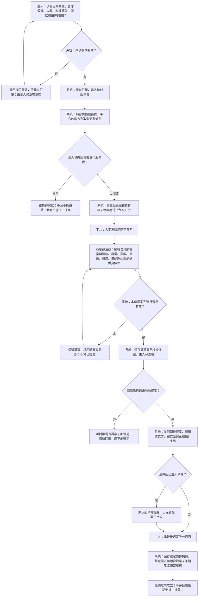
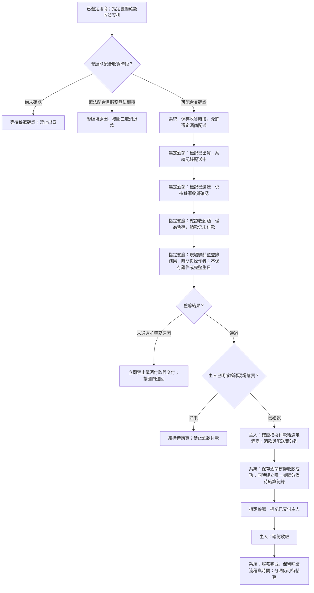
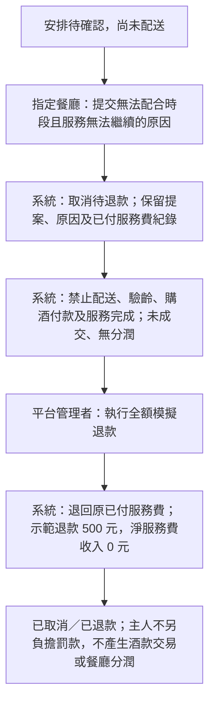
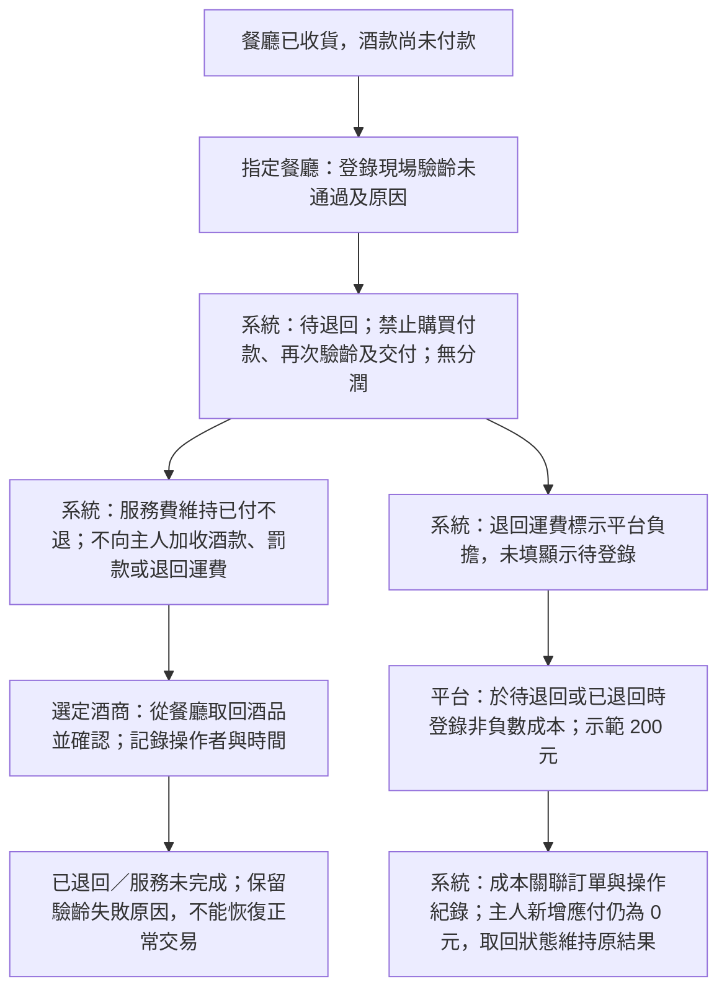
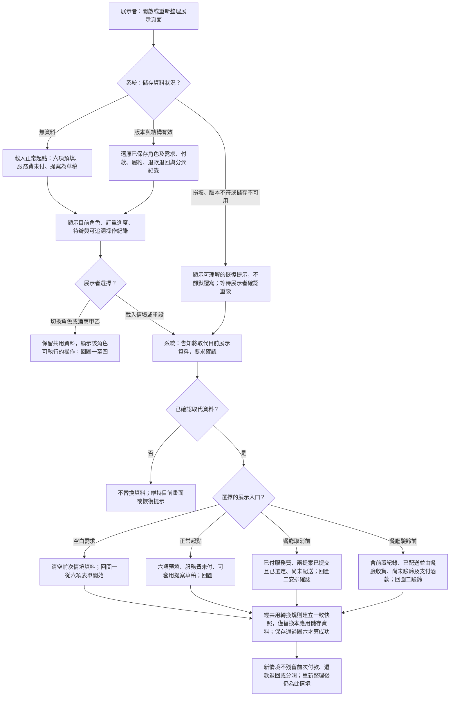
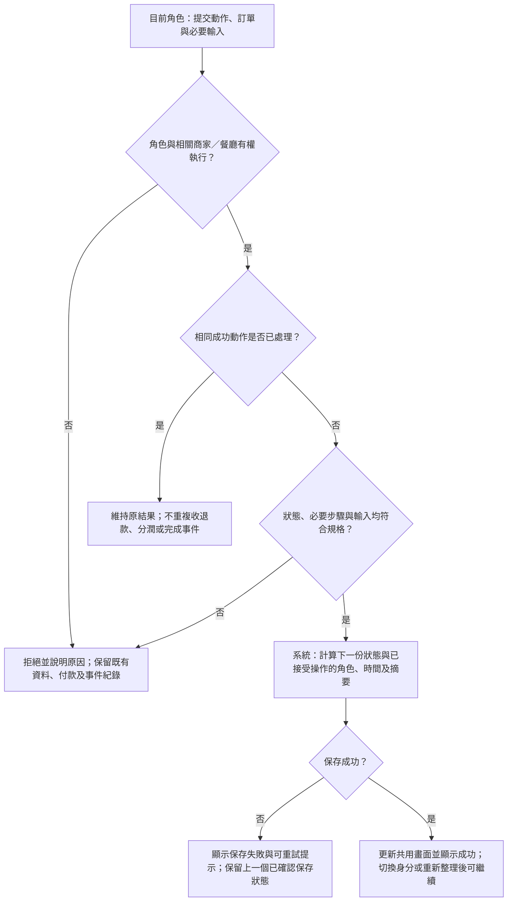
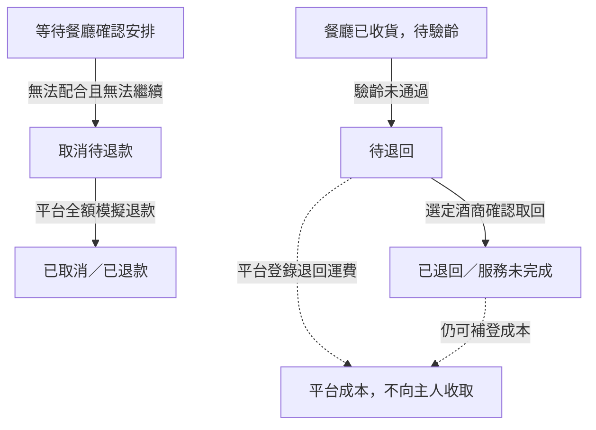

# Design

## Context

動機與範疇以 [proposal.md](proposal.md) 為準。2026-11-07 已查核工作目錄與 OpenSpec inventory：沒有應用程式、既有主規格、測試或套件設定；只有設定、技能與原提案 PDF。環境可執行 Node v24.22.0、npm 11.19.1 及 OpenSpec；PowerShell 的 `.ps1` 入口受執行原則限制，本次以 `.cmd` 入口執行 CLI，不修改系統原則。

這是新建且跨五個 capability 的應用，因此需要本設計。對話共識覆蓋原 PDF 的舊安排：目標改為課程展示；餐廳負責驗齡；驗齡後增加模擬酒款付款；新增酒商對餐廳分潤；四週真人商業試辦不屬此次交付。

實作前使用者已確認沿用本設計的純前端、npm、原生 CSS 與 localStorage，作為專案通用全端技術棧的此次 change 例外；並授權補齊 E2E 清單及設定 Playwright MCP。

## Goals / Non-Goals

**Goals:**

- 在單一瀏覽器切換角色即可完整演示，重新整理仍可繼續；所有頁面使用同一份訂單資料。
- 以明確且可測試的轉換規則維護正常、取消與退回分支；UI 隱藏按鈕之外，資料操作層也驗證角色及前置條件。
- 金額、付款對象、服務完成與分潤結算各自表達，不以一個「完成」布林值混用。
- P0 於 2026-11-12 完成；以情境入口縮短展示操作，不犧牲核心流程可手動走完的能力。

**Non-Goals:**

- 不建置後端帳戶、多人即時協作、正式權限安全邊界、真實支付、物流或會計整合。
- 不把 localStorage 當正式營運資料庫；不處理交易後退貨、主人現場改量議價、換酒商或任意取消等第三種以上的業務流程。
- 不以完成結算、上線網址或新增商業分析作為 P0 必要條件；產品頁面不塞入程式架構及法規研究說明。

## Operation Flow

以下六張圖供規格審閱，描述預期操作，並不表示功能已實作。節點以「角色：動作」及「系統：結果」區分責任；跨圖節點會註明圖號。所有金額、付款及費率均為課程展示用。各圖的資料變更都適用圖六的角色、前置條件、重複操作及保存檢查。

### 圖一：建立需求、付服務費與比較選定

入口為主人已選定合作餐廳，從空白或正常示範起點建立需求。出口是鎖定條件並等待餐廳安排；此時酒款尚未購買、尚未付款，也未產生分潤。

對照 [banquet-matching 規格](specs/banquet-matching/spec.md)：`從空白建立有效需求`、`阻止無效需求`、`未付款不得邀請`、`主人完成服務費模擬付款`、`酒商送出完整提案`、`提案缺項不得送出`、`只有一份提案時尚不能選定`、`選定後進入協調`、`選定後禁止改價與重選`。等待付款或另一份提案的出口表示尚待該角色操作，並非取消或完成訂單。

費用審閱範例（`費用比較無重複計算`）：酒款 6000 元＋配送 200 元＋餐廳現場另收 300 元＋已付服務費 500 元＝估計總支出 7000 元；後續估計支出 6500 元。已付服務費不再重複收取，超預算只提醒，不自動排除提案或宣稱最佳。

### 圖二：餐廳協調、配送、驗齡與正常完成

入口為圖一已選定酒商且尚未配送。餐廳確認時段、酒商送達、餐廳收貨、現場驗齡、主人購買付款及交付收取皆為不同步驟；唯一正常完成出口在主人確認收取之後。

對照 [restaurant-fulfillment 規格](specs/restaurant-fulfillment/spec.md)：`確認安排後開始配送`、`收貨安排未確認`、`餐廳確認收到酒`、`餐廳登錄通過`、`未驗齡或未通過時不得購酒付款`、`未確認購買不得付款`、`完成酒商收款模擬`、`正常完成服務`、`阻止提早完成`、`重複確認收取`。未收到驗齡結果時仍等待餐廳，不得跳至購買或付款；所有越步與錯誤角色操作依圖六拒絕。

對照 [restaurant-revenue-share 規格](specs/restaurant-revenue-share/spec.md)：`顯示完整費用流向`、`成交分潤正確排除其他費用`、`付款後形成唯一紀錄`、`服務完成但分潤尚待結算`。選定與收貨均不建立分潤，只有酒款模擬付款成功才建立；切換角色或重新整理不重複建立。

| 款項／紀錄 | 正常成交示範與責任 |
|---|---|
| 平台服務費 | 主人先付平台 500 元；平台不收酒款佣金 |
| 酒商模擬收款 | 主人付選定酒商 6200 元＝酒款 6000 元＋配送 200 元 |
| 餐廳現場費用 | 300 元，現場另收，不併入酒商模擬付款；規格僅要求標示，未另設收款確認流程 |
| 酒商應付餐廳分潤 | 四捨五入至整元：6000 元酒款成交額 × 示範 10%＝600 元；不含其他費用，也不加到主人支出 |
| P0 出口 | 服務完成與分潤待結算分開顯示；酒商支付分潤、餐廳確認收款為 P1，不納入本圖 |

### 圖三：餐廳無法配合，取消並全額退服務費

入口限於安排待確認、已付服務費且尚未配送的訂單。異常終止後只能處理本分支退款，不能繼續正常履約。

對照 [service-exceptions 規格](specs/service-exceptions/spec.md)：`無法配合收貨而取消`、`取消退款完成`、`防止退款重複與錯誤角色`；以及 [分潤規格](specs/restaurant-revenue-share/spec.md)的 `失敗訂單不產生分潤`。退款不可超過原付款，非平台角色或重複退款依圖六維持原結果。

### 圖四：驗齡未通過、酒商取回與平台成本

入口為餐廳已收貨、尚未驗齡與支付酒款。取回事實與平台成本登錄分別追蹤：成本未填不阻止酒商確認取回，也不能當作零元。

兩條由「待退回」分出的線是獨立工作，沒有先登錄成本才能取回的門檻。若酒商已取回但成本未填，仍顯示「已退回」與「成本待登錄」。非選定酒商不得代為確認取回；需要重演正常流程須使用新需求或情境重設。

對照 [service-exceptions 規格](specs/service-exceptions/spec.md)：`驗齡未過不得付款或交付`、`酒商完成取回`、`記錄平台退回成本`、`成本未填仍可追蹤實際取回`、`驗齡失敗後不能切換角色繞過`；以及 [分潤規格](specs/restaurant-revenue-share/spec.md)的 `失敗訂單不產生分潤`。

### 圖五：展示入口、重新整理與情境重設

入口為開啟或重新整理同一瀏覽器、同一網站來源的展示。四種情境入口都須確認替換資料，不能以直接改狀態跳過前置紀錄。圖中「未確認替換就保留資料」是確認介面的輕微呈現假設，未新增業務取消流程。

對照 [demo-workspace 規格](specs/demo-workspace/spec.md)：`主人切換至酒商`、`重新整理後繼續交付`、`載入餐廳取消情境`、`載入驗齡失敗情境`、`重設不殘留前次資料`、`觀眾辨識模擬付款`。切換身分保留資料，只有確認載入或重設才替換；不清除其他網站儲存資料。桌機主要操作使用繁體中文、文字狀態與可見標籤；付款不要求真實卡號。

### 圖六：所有操作共用的檢查與保存結果

入口為任一角色提交動作。先確認授權、前置條件與輸入，成功保存後才呈現新狀態；被拒絕或重複操作不新增成功事件，也不改變金額。圖一的表單與提案錯誤訊息是本圖輸入檢查的具體呈現。

前置條件包含：服務費未付不能邀請、兩份有效提案前不能選定、餐廳安排未確認不能配送、未收貨不能驗齡、未通過驗齡或未確認購買不能付款、未收款不能交付、未交付不能完成。取消及退回狀態只接受各異常分支的退款、取回與成本操作，不能靠切換角色恢復正常；完成訂單的流程唯讀。此圖只呈現使用者可重試的提示，未設定自動重試政策。

對照 [demo-workspace 規格](specs/demo-workspace/spec.md)：`非法角色動作不改變狀態`、`無法保存時顯示錯誤`、`同一付款重複點擊`；以及上述各圖引用的越步、重複退款、重複確認收取與異常不得恢復情境。所有圖的等待出口可在指定角色完成該步後接續；圖三與圖四的異常出口均不算正常服務完成。

## Decisions

### 1. 採 React + TypeScript + Vite 的單頁展示應用

在專案根目錄新增應用，避免另建第二個專案；以 npm lockfile 固定依賴，採原生 CSS 與少量共用元件。Vite 支援開發伺服器及靜態建置，[官方指南](https://vite.dev/guide/)可作為實作依據。實作時鎖定能在現有 Node 環境通過安裝與建置的版本，不在規劃階段猜測版本號。

替代方案：全端框架及資料庫會加入帳戶、部署與同步工作，但本次是一人、同瀏覽器切換示範角色；純 HTML 腳本則較難維護跨角色狀態。此選擇是工程假設，不改變已同意的功能。

建議新增檔案邊界：

| 位置 | 責任 |
|---|---|
| `src/app/` | 應用殼層、示範身分與頁面切換 |
| `src/domain/` | 資料型別、狀態轉換、角色與狀態防護、金額計算 |
| `src/features/host/` | 需求、比較、服務費與酒款模擬付款、確認收取 |
| `src/features/platform/` | 邀請酒商、全局進度、退款與退回成本 |
| `src/features/merchant/` | 商家身分、提案、出貨送達、取回、分潤查看 |
| `src/features/restaurant/` | 收貨安排、收貨、驗齡、交付、分潤查看 |
| `src/components/` | 進度、金額明細、操作紀錄、表單及確認對話框 |
| `src/demo/` | 示範資料與一致的情境工廠 |
| `src/persistence/` | 版本化 localStorage 載入、驗證及保存 |
| `src/domain/*.test.ts` | 流程與金額的不變條件測試 |
| `docs/demo-runbook.md` | 本機啟動、八分鐘腳本、情境與驗收紀錄 |

以上為未來實作位置；本次 propose 僅建立 OpenSpec 規劃文件。

### 2. 共用狀態轉換，保存成功後再顯示成功

使用 React 共用狀態搭配純轉換函式。每個 action 帶入角色與示範帳號、訂單 id、動作及必要輸入；先驗證前置條件，計算下一份快照，保存成功後更新畫面。失敗維持上一個已保存狀態並顯示錯誤。React [reducer 指南](https://react.dev/learn/extracting-state-logic-into-a-reducer)支持把分散的更新邏輯集中處理。

不用每個頁面各自管理訂單，避免角色切換後資訊不一致。角色限制是展示流程的一部分，不宣稱可防止本機開發者工具竄改；正式權限需未來後端實作。

正常進度與允許動作如下，明細結果另有獨立欄位：

| 目前進度 | 角色／動作 | 下一個進度 |
|---|---|---|
| `draft` | 主人提交有效需求 | `service-fee-pending` |
| `service-fee-pending` | 主人模擬支付服務費 | `invitation-pending` |
| `invitation-pending` | 平台邀請兩家酒商 | `proposals-pending` |
| `proposals-pending` | 兩家各自送出有效提案 | `comparison-ready` |
| `comparison-ready` | 主人選定一家並保存條件快照 | `restaurant-pending` |
| `restaurant-pending` | 餐廳確認收貨時段 | `delivery-ready` |
| `delivery-ready` | 選定酒商標記出貨 | `in-transit` |
| `in-transit` | 選定酒商標記送達 | `restaurant-receipt-pending` |
| `restaurant-receipt-pending` | 餐廳確認收貨 | `age-check-pending` |
| `age-check-pending` | 餐廳登錄驗齡通過 | `purchase-pending` |
| `purchase-pending` | 主人明確確認現場購買 | `wine-payment-pending` |
| `wine-payment-pending` | 主人模擬付款給酒商 | `handover-pending` |
| `handover-pending` | 餐廳標記交付 | `host-receipt-pending` |
| `host-receipt-pending` | 主人確認收取 | `completed` |

兩條異常只從明確狀態分岔：

終止分支不允許改驗齡結果恢復交易；重演使用重設或新需求。已完成狀態不得重複付款或交付。重複 action 不改變金額、不新增成功事件。分潤仍待結算不阻擋 `completed`。

### 3. 資料模型保留必要責任及金額，不保存證件

| 實體 | 主要內容 |
|---|---|
| DemoAccount | id、四種 role、merchantId 或 restaurantId；兩家酒商有不同帳號 |
| BanquetRequest | id、hostId、日期時間、restaurantId、人數、料理類型、酒款預算、偏好 |
| Proposal | id、requestId、merchantId、draft/submitted、酒款項目、運費、餐廳費用快照、理由、配送條件、限制 |
| ServiceOrder | requestId、邀請對象、selectedProposalSnapshot、主要進度、各確認時間 |
| Payment | orderId、kind（service/wine）、payee、各項金額、unpaid/paid/refunded、模擬旗標 |
| AgeCheck | orderId、pending/passed/failed、失敗原因、restaurantActorId、checkedAt；無身分證與生日 |
| ReturnRecord | pending/returned、原因、merchantActorId、returnedAt、平台運費 nullable、costOwner=platform |
| CommissionRecord | orderId、merchantId、restaurantId、wineAmount、rateBps、amount、pending 狀態 |
| Event | id、orderId、actorId、action、時間、必要摘要；只記已接受的操作 |

已選定提案以快照鎖定，避免後改價影響付款及分潤。餐廳費用由預設合作資料提供，兩家提案使用同一份餐廳費用，避免同一餐廳出現無解釋的費差。

### 4. 金額規則與可調整的示範值

採整數新臺幣，數量為正整數；分潤比例以基點表示，最後四捨五入至整元。資料內使用示範值，不建置費率管理後台。

| 項目 | 示範值／規則 |
|---|---|
| 平台服務費 | 500 元，主人先付平台 |
| 酒商甲酒款 | 6 瓶 × 1000 元 = 6000 元；各瓶容量明列 |
| 酒商乙酒款 | 6 瓶 × 1100 元 = 6600 元；理由與酒款不同 |
| 配送費 | 甲 200 元、乙 0 元；均明列 |
| 餐廳費用 | 300 元，現場另收，僅為示範政策 |
| 餐廳分潤 | 示範 10%；只乘成功支付的酒款小計 |
| 驗齡失敗退回運費 | 示範 200 元，由平台登錄及吸收 |

`估計總支出 = 服務費 + 酒款小計 + 配送費 + 餐廳費用`。`酒商模擬收款 = 酒款小計 + 配送費`；此配送費收款安排是本版明確的展示假設。`餐廳分潤 = round(已支付酒款小計 × rateBps / 10000)`，不再加到主人支出。酒商甲案例的總支出為 7000 元，酒商收款 6200 元，餐廳分潤 600 元。

選定提案不是購買，不產生分潤。兩類失敗都沒有成功酒款交易，分潤顯示未產生。平台收入只列服務費扣退款，退回運費另列成本；不把簡化差額標成完整企業獲利。

### 5. 單一瀏覽器保存及情境資料

以命名專用 key `banquet-wine-demo:v1` 保存 schemaVersion、帳號、訂單、提案、各紀錄與目前角色。[localStorage 文件](https://developer.mozilla.org/en-US/docs/Web/API/Window/localStorage)說明其資料按網站來源保存並可跨瀏覽器工作階段保留；本作品不保證跨瀏覽器或跨網址同步，也不支援多分頁同時編輯。

載入時檢查版本及最小結構。無資料時載入正常起點；資料損壞、版本不符或儲存不可用時顯示可理解的恢復提示，不靜默覆寫。只有使用者確認重設後才替換本應用的 key，不呼叫清除整個網站儲存的操作。

四個展示入口：空白需求；正常起點（六項示範資料預填、未付款、提案草稿可套用）；餐廳取消前（已付服務費、兩提案已提交及選定）；驗齡前（含前述紀錄、已配送並由餐廳確認收貨）。情境工廠以與正式操作相同的轉換規則產生快照，避免載入出現未付服務費卻已到貨等不一致狀態。宴客日期以載入日後七天為預設並標示 Asia/Taipei，避免展示資料到期。

### 6. 畫面以一筆訂單為主線

共用頁首提供四角色切換；酒商角色內可切換甲／乙。另有清楚分離的「展示工具」區放情境入口與重設。主要畫面使用訂單列表／摘要、流程進度、當前角色待辦及操作紀錄，不堆疊無關儀表板。

主人畫面集中需求、提案比較與下一步；酒商畫面集中受邀提案與配送／取回；餐廳畫面集中時段、收貨、驗齡與交付；平台畫面集中邀請、例外及費用紀錄。付款確認框顯示收款方與項目，驗齡結果二選一且未通過需原因。所有模擬付款均以標籤與簡短說明辨識。

視覺暫採繁中、暖白底、深酒紅主色、清楚表格與狀態標籤；這是可調整的設計預設，不加入製作品牌識別或 AI 圖像的依賴。桌機 1366×768 為驗收尺寸，表格可在自身區域捲動，主要動作可用鍵盤操作；手機精修非交付門檻。

### 7. P0 與 P1 邊界

五份 specs 定義 P0，其中分潤 capability 只要求成交後金額與待結算紀錄。P1 是酒商標記已支付、餐廳確認已收到的兩步模擬結算；先完成 P0，再決定是否納入。未實作 P1 時不要放可點卻無作用的按鈕，不把 P1 的缺漏算成未通過 P0。若後續選擇實作 P1，另補充其規格與任務，維持本次驗收清楚。

### 8. 驗證及交付順序

以純狀態轉換與金額函式進行針對性單元測試，採 [Vitest 官方指南](https://vitest.dev/guide/)所述測試工具；再於瀏覽器實走三條流程、刷新與重設。重點是角色限制、驗齡付款門檻、重複操作、退款金額、未成交零分潤，以及保存失敗的處理，不寫與畫面實作一對一的冗餘測試。

建議時程為可調整的工作順序，不是假定每天可投入的工時：

| 日期 | 完成條件 |
|---|---|
| 11/07 | 規劃定案；後續收到實作指令才開始工程 |
| 11/08 | 應用殼層、資料模型、角色切換及保存；需求與提案可操作 |
| 11/09 | 正常流程從需求走到主人確認收取 |
| 11/10 | 取消退款、驗齡退回、平台成本、基礎分潤與展示載入完成 |
| 11/11 | 流程與金額測試、瀏覽器驗收、文件與演練；決定 P1 延後 |
| 11/12 | 完成修正、建置交付版本及八分鐘完整演練；凍結新增功能 |
| 11/13–11/14 | 使用已驗收版本準備繳交，不新增必做範疇 |

## Risks / Trade-offs

- [單一瀏覽器資料可能被清除] → 每次展示前確認資料保存可用，保留一鍵載入；在操作手冊說明資料範圍，不承諾跨裝置同步。
- [多個角色看似有安全隔離但實際是示範切換] → 顯示展示模式，操作層仍驗證角色；不存敏感或真實個資。
- [驗齡及付款被誤認已完成法規確認] → 保留模擬標示；正式酒品契約、餐廳授權、付款與退款政策均列為未來營運驗證，不以直接付酒商推論合法。
- [未取得合作餐廳與酒商] → 僅使用虛構或明確示範資料，合作分潤及餐廳費用不當成實證。
- [分潤功能拖延正常與異常流程] → P0 僅金額與待結算，P1 延後不影響交付。
- [範圍膨脹] → 本版明確鎖定兩份提案、選定後不能改單、兩類異常；新增功能先進後續版本。

## Migration Plan

這是新專案，無舊資料遷移。實作完成後以 `npm.cmd run build` 建立靜態產物，`npm.cmd run preview` 在本機驗收；首次交付以可在目前電腦重現的本機展示為基線，公開部署不屬本次必要工作。

保留 lockfile、示範資料與操作手冊。若新版本無法展示，回到上一個已驗收建置及相容的資料版本；資料不相容時讓展示者確認重設，不擅自嘗試遷移真實資料。正式上線的儲存、身份驗證及金流設計須另立 change。
