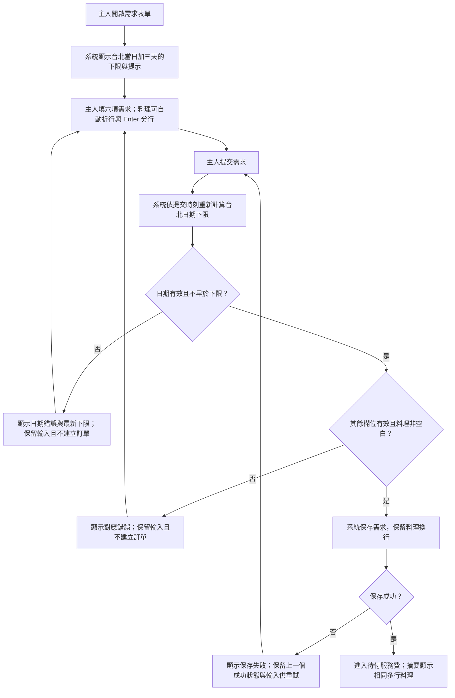
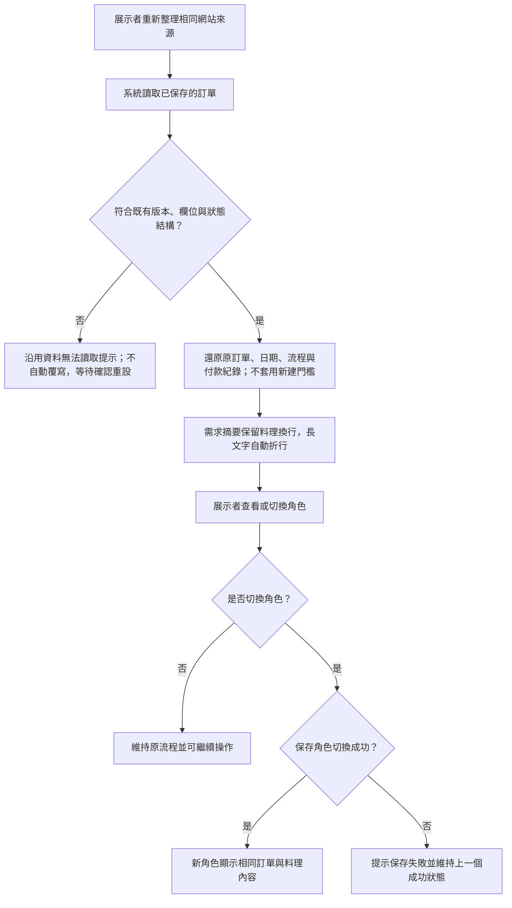

# Design

## Context

變更動機見 [proposal.md](proposal.md)。本修正直接作用於既有 React Demo：需求由 `RequestForm` 呼叫 `transition()` 建立，成功後才寫入 localStorage；沒有需求編輯流程。日期目前是沒有時區偏移的字串，畫面標示 Asia/Taipei，但 `Date.parse()` 會依執行環境解讀。日期輸入沒有下限，且表單為 `noValidate`。

`validateRequest()` 同時被建立需求與 `validState()` 載入驗證使用，因此日期門檻不能直接混入保存資料的通用驗證。`cuisine` 原本就是字串，JSON 可保留換行；需調整的是單行輸入與摘要呈現。既有 CSS 已有 textarea 基本樣式。`scripts/e2e-case.js` 的共用填表資料寫死 2026/11/21，加入限制後會逐漸失效。

本設計跨表單、領域驗證、保存及測試，並涉及既有資料相容性，符合建立 design 的條件。

## Goals / Non-Goals

**Goals:**

- 讓日期選擇提示與提交驗證共用同一套台北日曆日期規則。
- 分離「資料可讀取」與「當下可建立需求」，保留舊訂單相容性。
- 在不變動資料模型的前提下提供多行料理輸入與一致摘要。
- 以可控制時間的測試覆蓋日期邊界，避免依賴測試機的當日與時區。

**Non-Goals:**

- 不加入營業日、假日、每日截止時間、餐廳可預約時段或最大預約日期。
- 不新增訂單改期、到期自動取消、歷史訂單重新審核或需求編輯流程。
- 不改動付款、角色權限、履約及分潤流程；不擴建後端、登入或跨裝置能力。

## Operation Flow

### 建立宴客需求

入口為主人開啟空白或預填需求。系統顯示台北日期下限，料理可分行；提交後才以最新日期驗證。日期或其他欄位錯誤回到原表單；保存失敗保留上一個成功狀態供重試；保存成功才進入待付服務費。

日期分支對應 `阻止過早宴客日期`、`接受最早日期邊界`、`跨日提交重新驗證` 與 `依台北日曆處理跨月跨年與裝置時區`；料理及欄位分支對應 `提交多行料理內容`、`阻止只有空白或換行的料理內容` 與既有無效需求情境。保存失敗分支沿用 `無法保存時顯示錯誤`。

### 還原既有訂單與切換角色

入口為重新整理載入資料，或在成功載入後切換角色。日期接近、過期及舊版訂單都不套用新建門檻；真正的結構損壞仍走既有恢復提示。此圖不新增到期取消或重新審核流程。

正常分支對應 `日期接近或已過仍可還原訂單`、`舊版已保存訂單維持相容`、`多行料理跨重新整理與角色切換保存` 及 `重新整理後繼續交付`；角色保存失敗沿用現行保存契約。兩張圖描述預期操作，實作與功能驗收結果另見 `tasks.md` 及 `e2e-testing.md`。

兩張圖已以本機 Mermaid CLI 成功渲染並通過語法檢查，沒有使用線上渲染服務。審閱用圖檔：[建立需求](operation-flow/flow-1.svg)、[還原訂單](operation-flow/flow-2.svg)；同目錄保留 `.mmd` 原稿。渲染驗證不代表產品功能測試通過。

## Decisions

### 1. 以台北日曆日計算日期下限

沿用前一輪討論的日期定義：取得現在時刻在 Asia/Taipei 的年、月、日，加三個日曆日，再組成 `YYYY-MM-DDT00:00`。提交日 2026/11/08 的下限為 2026/11/11 00:00，包含邊界；即使提交時間為 18:00 也一樣。

在領域層集中日期工具，透過明確時區取得日期部分，再用不依賴主機時區的日曆運算處理月底與年底。新建輸入先驗證實際存在的日期時間，再以標準化的台北本地日期時間比較；不把沒有偏移的輸入交由主機時區推斷。測試可明確傳入現在時刻，正式流程則於執行建立命令時取得現在時刻。

不採直接加 72 小時，因其在同一天產生的最早時間不同，不符合「最早日期是三天後」的需求；不採電腦本地日期，避免裝置時區改變結果。預填值繼續使用台北當日加七個日曆日 18:00，並共用相同日期算法。

### 2. 僅在建立需求時套用預約門檻

保留供載入使用的一般欄位有效性驗證；建立命令先檢查日期有效性與下限，再檢查其餘欄位，日期門檻使用獨立驗證。`validState()` 繼續只驗證既有欄位與狀態，不引用當下最早日期，也不因宴客日期已過而改變流程。

對已保存的合法舊格式維持讀取相容，包括舊版可能建立的過早日期；不重新以新建立規則追溯審核。新建路徑則一律執行新規則，不提供略過旗標。這比把可選參數加進同一驗證函式更能避免載入時意外套用當日門檻。

### 3. 日期選擇與提交雙重防呆

`RequestForm` 以共用日期工具設定 `min`，保留 Asia/Taipei 提示並顯示「至少提前三個日曆日」與實際最早日期。首次呈現及重新聚焦日期欄位時更新；提交時領域層重新計算，過早日期遭拒後同步更新提示，不自動改寫使用者輸入。

維持現有應用錯誤區與 `noValidate`，讓手動輸入或原生選擇器差異都走一致的領域驗證。錯誤需明確指出宴客日期與最早可選日期；拒絕不產生訂單或成功事件，保留整份表單供修正。只加 `min` 無法保護建立路徑，因此不足以完成此變更。

### 4. 多行輸入與摘要一併調整

料理改為具原標籤的 textarea，初始三行、允許垂直調整並依欄寬折行。Enter 維持文字輸入語意，不觸發提交。繼續以 `trim()` 結果判斷是否有內容，但保存原文字，不將換行壓成空白。

各角色共用的料理摘要以一般 React 文字呈現，針對料理內容套用保留換行與長字串折行的樣式，例如 `white-space: pre-wrap` 與 `overflow-wrap: anywhere`，並確保容器可縮小。不使用 HTML 字串轉換，避免輸入文字被當成標記；不修改全站摘要或其他表單欄位的空白行為。

### 5. 測試時間與既有流程回歸

單元測試在 `src/domain/model.test.ts` 驗證日曆算法、建立命令的拒絕與接受、原狀態不變，以及時間推移後保存還原。日期案例明確傳入現在時刻，涵蓋台北與 UTC 當日不同的時刻、月底、年底及閏日。

E2E 以 Playwright MCP 控制隔離瀏覽器，透過頁面時鐘設定與前進模擬日界；裝置時區差異以隔離瀏覽器 context 設定為 UTC 重跑。正式應用不新增測試時鐘 UI。舊版資料相容性只允許載入測試前保留的、經舊版公開 UI 建立的真實狀態快照，不手工偽造成功狀態；其餘成功狀態均透過 UI 建立。

共用 E2E 填表資料使用固定測試時鐘的相對日期或測試當日的台北加七天，移除固定 2026/11/21；新案例、步驟與證據全部以 [e2e-testing.md](e2e-testing.md) 為單一來源。原封存清單保留歷史結果，新執行結果放在本 change。

## Risks / Trade-offs

- [裝置時區影響日期字串解讀] → 使用明確台北日期部分及無主機時區相依的日曆運算；測試 UTC 裝置情境。
- [頁面跨午夜仍顯示舊門檻] → 建立命令總是重新驗證，拒絕後更新提示；聚焦時刷新下限，保留原輸入。
- [新門檻讓舊訂單無法讀取] → 載入只做原有資料驗證；以日期接近、過期及舊版快照測試鎖定相容性。
- [長料理內容撐開桌機版面] → 只針對料理區保留換行並允許長字串折行，於 1366×768 驗收輸入及各角色摘要。
- [本機時間不準影響門檻] → 此 Demo 使用裝置時鐘取得現在時刻，不新增伺服器校時；操作手冊明示時間基準。
- [MCP 瀏覽器工具不支援時間或時區控制] → 測試執行前確認工具能力；若缺失，明確記錄受阻案例並保留單元驗證，不能將單元結果當作 E2E 通過。

## Migration Plan

1. 在後續 apply 階段先透過現有舊版 UI 於隔離來源保存相容性快照，再進行程式修改。
2. 依 tasks 分組完成日期工具、建立命令、表單與摘要；同步補測試及 `docs/demo-runbook.md`。
3. 維持 `banquet-wine-demo:v1`、`schemaVersion: 1` 與欄位結構，不搬移、刪除或自動重寫舊資料。
4. 通過單元測試、建置與本 change 的 E2E 清單後提供審閱；此 propose 不執行產品驗收。
5. 若需回復程式，回復此次程式修改即可；保存資料仍是原格式，不需要逆向資料遷移或要求使用者重設。
