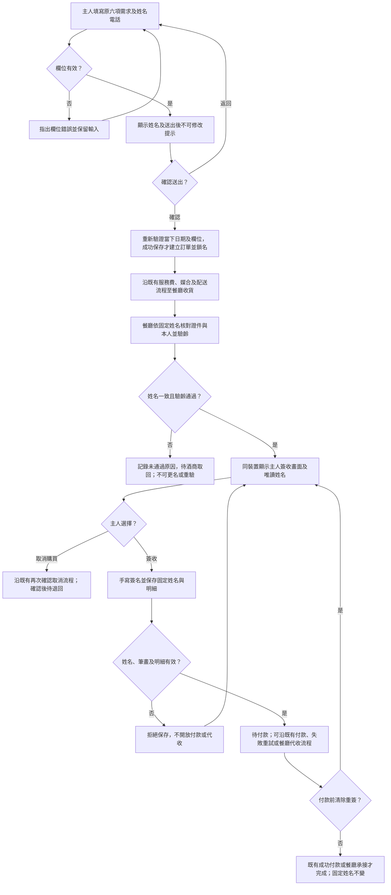
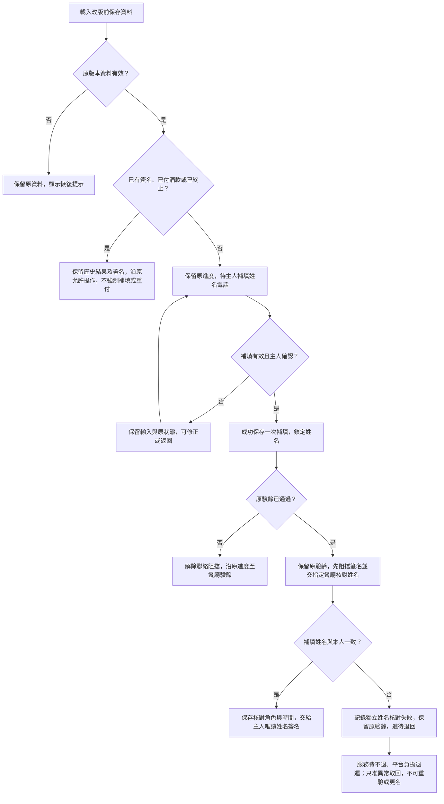
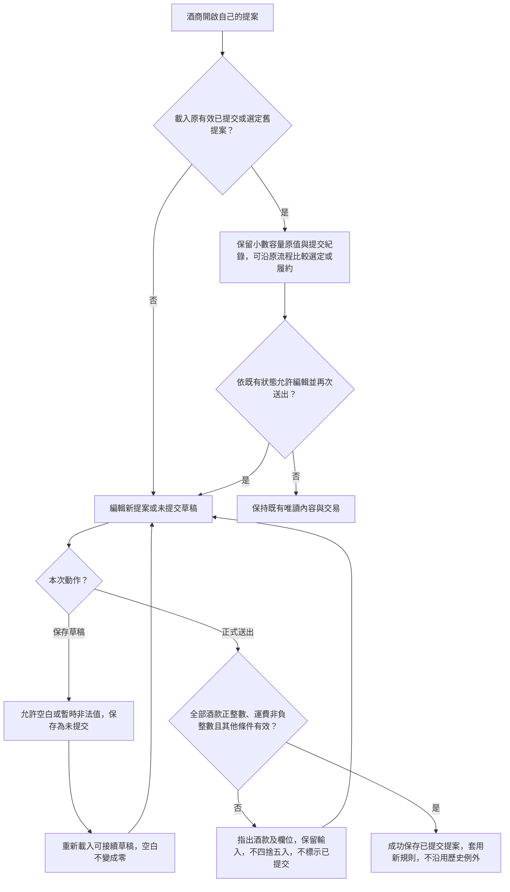
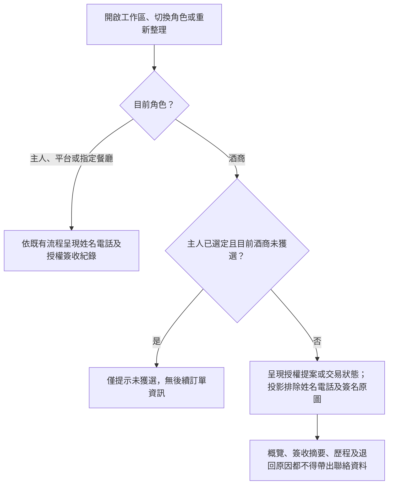
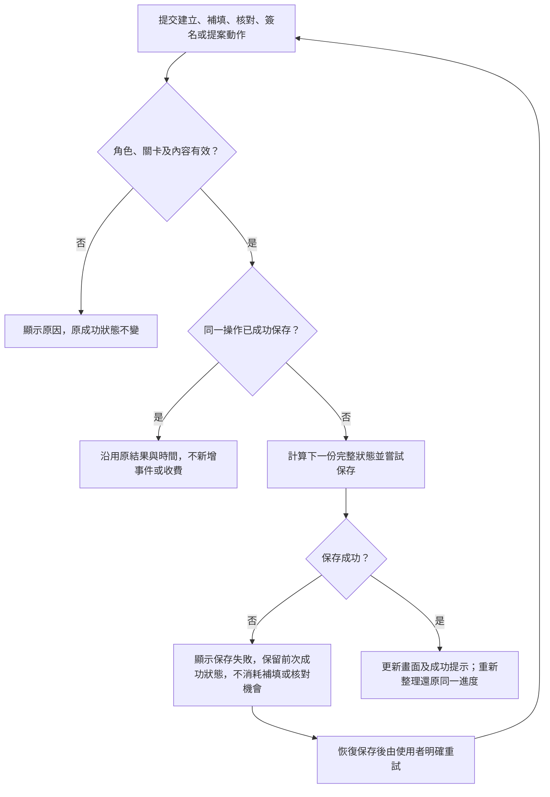

# Design

## Context

動機與確認範圍見 [proposal.md](proposal.md)。現有 `src/domain/model.ts` 的 Request 只有原六項資料，建立後沒有需求編輯命令；`signature-save` 接受任意非空姓名，`signatureValid()` 只檢查筆畫與交易快照。容量目前接受有限正數，瓶數／單價已用安全整數，運費允許 0；草稿不套用正式驗證。`App.tsx` 數字空白以 NaN 表示，JSON 保存後需正確還原成未填，而非 0。

`storage.ts` 與 `legacy.ts` 的 v2／v1 讀取共用目前驗證器；直接把新必填及容量整數條件加進共用驗證會誤判舊資料。`Checkout.tsx` 以原簽名或空白初始化可編輯姓名，且只要 checkout mode 非 none 就蓋過工作區。各角色共用完整 Order；選定酒商的簽收摘要目前也顯示署名，不能只改需求概覽。

本案是現有純前端 Demo 的延續，沿用 React、TypeScript strict、Vite、原生 CSS、npm、localStorage 與現有角色切換。現有 `docs/demo-runbook.md`、四個展示入口及 v1 夾具可重用，不引入一般專案預設的後端與資料庫。

## Goals / Non-Goals

**Goals:**

- 在領域命令與畫面同時固定姓名，讓既有付款／代收仍使用有效且未被替換的簽名。
- 將新提交驗證、歷史還原驗證、舊單補填及餐廳姓名核對分開，使有效歷史資料可持續保存。
- 保留 commit 先保存成功再顯示成功、角色授權、重送去重及終態限制。

**Non-Goals:**

- 正式帳戶驗證、跨裝置同步、證件影像、OCR、筆跡或姓名自動辨識、電話簡訊及真實金流。
- 送出後更名、失敗後重驗、代簽、取消後直接重建第二筆需求、重設以外的訂單歷史。
- 清理舊提案小數、重算交易金額或回寫歷史簽名快照。

## Operation Flow

### 1. 新需求、本人核對與固定姓名簽收

入口為主人建立新需求；對應「姓名電話缺漏不得建立需求」「返回修改姓名後再送出」「以需求姓名核對本人」「簽名不能替換姓名」「清除重簽沿用固定姓名」及「新單姓名不符走未通過」。姓名一致由餐廳人工核對，系統不辨識筆跡。付款與代收沿既有流程，不新增完成條件。

取消確認若返回，沿原簽名／待付款進度，固定姓名不變；若確認取消才進退回。建立時最終驗證失敗（含跨日）回到表單並保留輸入；任何保存節點失敗均走第 5 圖，不建立成功結果。

### 2. 舊單一次補填及已驗齡單姓名核對

入口為有效 v1／v2 訂單還原；無訂單時沿新建流程。對應「未驗齡舊單一次補填」「已驗齡舊單待核對姓名」「已簽未付舊單保留原簽名」「保留原驗齡但終止簽收」及「已付與終止舊單維持原結果」。已簽／已付／終止的分類優先，不能被補填流程重新打開。

### 3. 提案草稿、整數送出與歷史例外

入口為受邀酒商查看本人提案；舊例外僅限相同歷史提交內容，重新提交均驗證新規則。對應「保存空白及小數草稿」「多酒款逐列驗證後重試」「正整數提案及免運可提交」「舊提交及選定提案可繼續」「舊已提交提案重新編輯送出」。

### 4. 聯絡資料可見範圍

入口為每次顯示工作區或角色變化；對應「授權角色查看聯絡資料」「兩家酒商選定前後不見聯絡資料」「姓名不經簽收摘要或歷程洩漏」。所有呈現位置共用角色投影，不把完整資料藏在 DOM 中。

### 5. 共用保存、拒絕與明確重試

適用前述每個改動狀態的動作；對應「補填或核對保存失敗可重試」與既有「無法保存時顯示錯誤」。同一操作去重僅適用有識別碼的已接受動作；不同新請求仍先驗證角色與資格。

所有圖皆為待實作的行為設計；圖表渲染成功不代表功能或 E2E 通過。五張圖已於 2026/11/09 使用本機 Mermaid CLI 12.2.0 與已安裝 Chrome 成功渲染 SVG（未使用線上服務）：[新單簽收](operation-flow/flow-1.svg)、[舊單補填](operation-flow/flow-2.svg)、[提案驗證](operation-flow/flow-3.svg)、[角色可見性](operation-flow/flow-4.svg)、[保存重試](operation-flow/flow-5.svg)。圖稿及渲染檔置於 [operation-flow](operation-flow/)。

## Decisions

### 1. 聯絡資料與確認提交

Request 增加 `hostName`、`contactPhone`。新建命令使用必填字串；持久化型別允許僅供遷移的歷史缺值，由來源狀態限制，不能靠可選欄位讓新單漏填。姓名 trim 後採現有署名的 1–100 字界線，不限制僅能中文字或自動改寫中間空格。

電話使用 type tel 字串，不轉 Number。小型格式函式先辨識分機、移除主號碼中的空格／連字號以驗證，再保存一致的可讀文字，保留前導零與分機。實作假設：手機為 09 起頭共 10 碼，市話為 0 起頭（非 09）共 9–10 碼；分機接受「分機」、「#」、「ext」及其後數字。此為輸入格式檢查，不證明電話存在，不新增國際號碼轉換。測試須含有無分機、空白、英文字母及長度錯誤。

RequestForm 的送出先驗證並顯示姓名確認，再以最終確認動作呼叫 create；返回保留草稿。最後 create 仍重新檢查完整資料及當下台北日期，避免確認視窗跨日繞過三天門檻。沿用現有 Modal 呈現模式，但成功通知只能在 commit 成功後顯示。

替代方案為只在簽名頁設 readOnly；無法阻止其他命令提供不同姓名，故不採用。姓名送出後固定，電話也沿用目前無送出後編輯功能的邊界，不另開新編輯流程。

### 2. 姓名綁定與角色檢視

新單 `signature-save` 從固定需求取得姓名；若保留命令 name 參數則必須與固定值完全相符，不把參數寫回需求。清除只清筆畫與原簽名效力，不清固定姓名。交易快照保持既有結構，透過 Signature.name 與不可變固定姓名的交叉檢查綁定；付款、代收請求與承接均檢查此條件。無須重建舊快照。

新增明確的角色檢視投影／聯絡資料讀取 helper，供 App、Checkout 及簽收歷程使用。領域 transition 仍使用完整內部狀態，不能為了隱藏欄位而破壞操作資料。酒商檢視不得把聯絡資料、Signature.name、筆畫或含聯絡資料的摘要傳入呈現元件；不以 CSS 隱藏完整資料。角色切換與重新載入先決定投影，避免先渲染前一角色內容。

餐廳可見未通過完整原因；酒商的姓名核對不符原因採一般文字「姓名與本人不符」，避免自由填寫的原因帶入姓名電話。新產生事件只記「主人完成聯絡資料補填」「餐廳核對補填姓名」，不複製聯絡欄位；舊簽名姓名同樣受投影限制。保留未獲選酒商完全不讀後續訂單的規則。這是 Demo 的應用及呈現邊界，不是對本機開發工具的正式隔離。

### 3. 以獨立關卡管理補填及姓名核對

新增持久化 identity 區塊，記錄來源（新建／舊單待補／歷史保留）、鎖定姓名、補填操作者／時間，以及姓名核對 pending／passed／failed 與操作者、時間、原因。舊單若已有簽名，鎖定姓名取自真實既存署名；不捏造電話，也不修改舊簽名或其快照。

由 effective gate（contact-required／name-check-pending／none）控制能否進入驗齡及 Checkout，不另把原履約 status 改回前一階段。App 必須先處理 gate，再依 checkout.mode 呈現畫面，resume 也不能繞過。待補單可切換主人填資料；補填失敗保留草稿，成功才消耗一次補填機會。

新增僅主人可用的 `contact-complete` 命令：限有效舊來源、可正常履約、無簽名、無已付酒款、尚未成功補填；完整驗證、確認後一次保存。原驗齡 pending 的單解除聯絡阻擋後沿原流程前進；原驗齡 passed 的單轉為待餐廳姓名核對，不能直接簽名。新增僅指定餐廳可用的 `identity-check`，必須已補填且原驗齡已通過，記錄與固定姓名關聯的結果；通過才切至主人 guest 簽名。

補填／核對命令使用現有 operationId 與最新 stateRef，角色與資格檢查先於重送結果。相同操作重送不重記事件；不同姓名第二次提交拒絕，核對失敗不可改通過。維持 commit 成功才更新畫面；保存失敗不消耗補填、不留下核對成功狀態。

替代方案為將原 age 改回 pending 後重跑，會改寫歷史並牴觸沿用原驗齡結果，故不採用。

### 4. 姓名不符與既有退回流程

新單在原驗齡步驟核對姓名不符，使用既有未通過操作與必填原因，沿 age-failed 退回。不得把姓名文字相同視為系統已自動驗證本人；餐廳仍人工核對證件及現場者。

已驗齡通過的舊單若在補填姓名核對失敗，保留 age.result=passed，增加 `returnReason: identity-mismatch`，記錄獨立姓名核對結果後沿 return-pending → returned。保存驗證、退回摘要及平台成本都須識別此原因，不能為符合原 age-failed 驗證把 age 改成 failed。兩條路徑均不重收服務費、不退已提供服務的 500 元、不收酒款／罰款／退運，不建分潤或代收，退運由平台負擔；終止後不能重驗或補第二個姓名。

### 5. 整數驗證與歷史提案例外

正式驗證採 Number.isSafeInteger：容量／瓶數／單價 >=1、配送費 >=0；固定餐廳費與小計／總額安全範圍維持。輸入元件加 min、step=1 與可見說明，錯誤指出第幾款及欄位；不靠瀏覽器原生驗證取代領域驗證、不以 parseInt、四捨五入或截斷修正。純數值等價的 1.0／1e3 依目前 Number 轉換後分別視為 1／1000，不新增「僅允許數字字元」的業務規則。

草稿編輯可暫時空白或非法，保存仍標示未提交。持久化草稿空值明確以 null 表示並在載入還原為未填，不把 JSON 中的 null 當 0；拒絕送出保留本次本機編輯，不能假稱新內容已保存。

舊版有效已提交／選定提案在遷移時建立限定該提交內容的歷史來源記錄／內容指紋。還原與後續保存時，只對完全相同的舊提交快照允許有限正數容量；其他歷史合法性維持原規則。新提交與重新提交一律走新驗證，該提案被重新保存為草稿時移除其提交例外，不放寬整筆舊單中其他新提案。舊提案尚未選定時仍可被選定，選定快照繼承其已確認來源。

替代方案為以整筆訂單 legacy=true 放行小數，會讓舊單中的新提案繞過限制，故不採用；全部重驗則會破壞已確認的歷史保留。

### 6. 保存版本與舊資料分類

將 State 更新為 schemaVersion 3，保留 KEY=banquet-wine-demo:v1。分開凍結 v1、v2 原始格式驗證，先確認來源有效再純資料遷移；v1 沿既有 v1→v2 邏輯後補 v3 分類，v2 直接遷移。不能用新 validateRequest／validateProposal 驗證原始舊單，也不能將任意缺欄位的 v3 當成舊單。

| 舊單情況 | v3 分類與接續 |
|---|---|
| 無訂單 | 保留角色及 prefill，新建時必填 |
| 未簽名、未付酒款、尚可正常履約 | 待主人補填一次；驗齡前可保留既有進度，但驗齡及簽名受 gate 阻擋 |
| 上列且 age 已通過 | 補填成功後另待指定餐廳核對姓名 |
| 已簽名尚未付酒款 | 保留原署名、筆畫、快照與失敗嘗試；沿原付款／代收，不強制補資料 |
| 已付酒款、已完成或已承接代收 | 保留歷史結果；v1 已付未交付仍走既有相容收取，不補簽、不重付 |
| 取消／退回中或已結束 | 保留終態或異常進度，只准既有退款／取回／成本／收清操作 |

已簽舊單清除重簽時仍沿用由歷史署名鎖定的姓名，不藉清除改名或要求新增電話；已終止及已完成仍不能清除。遷移只讀不覆寫，成功操作才以 v3 保存；遷移本身不增造業務事件。真正損壞仍顯示既有恢復提示且保留原資料。

## Risks / Trade-offs

- [欄位唯讀但命令仍接受另一姓名] → 領域綁定固定值，付款及代收再驗證；以錯誤姓名命令做單元負向測試。
- [歷史例外擴及新提交] → 原始版本驗證與提案提交內容來源分離，重新提交必須嚴格驗證。
- [舊 guest 畫面先於補填 gate 顯示] → App 與 resume 共用有效關卡，重新整理與角色切換做 E2E。
- [姓名在簽名摘要或自由填原因流出] → 酒商投影排除姓名電話與原圖，原因採一般文字，甲乙對稱檢查 DOM。
- [單一瀏覽器示範誤認正式權限] → 延續展示說明，不新增正式登入承諾。
- [錯填姓名後無修改路徑] → 送出前確認，送出後維持使用者已確認的不可更名規則；不以重設自動刪除資料作補救。

## Migration Plan

1. 實作前從現有公開 UI 保存 v2 代表性資料：驗齡前、驗齡已通過未簽、已簽未付及失敗、線上完成、代收待收清／已收清、取消與退回；另保存 UI 可合法提交的小數容量與不完整草稿。沿用 archive 中只讀的 v1 fixtures，於本 change 的 legacy 目錄另存新快照與來源說明。
2. 先加原版本驗證與 v3 純遷移、身份關卡及正式驗證，再接上表單、角色投影與 Checkout；測試原始輸入及第二次保存／載入，不只測第一次遷移。
3. 更新 sampleRequest 及四個 scenario；正常預填使用模擬姓名電話，空白不填，其他入口透過合法 transition 建立。更新 README 及 demo-runbook。
4. 使用 npm.cmd run test -- --run、npm.cmd run build 及本案 E2E 清單驗證。規劃階段不執行功能測試、不勾選實作或 E2E 完成。
5. 回退前保留原 v1/v2 備份與當前 v3；舊程式不可直接讀 v3，不把版本號改回 v2 假裝可逆。必要時僅在隔離展示瀏覽器用備份還原，不能以清空資料掩蓋相容問題。
