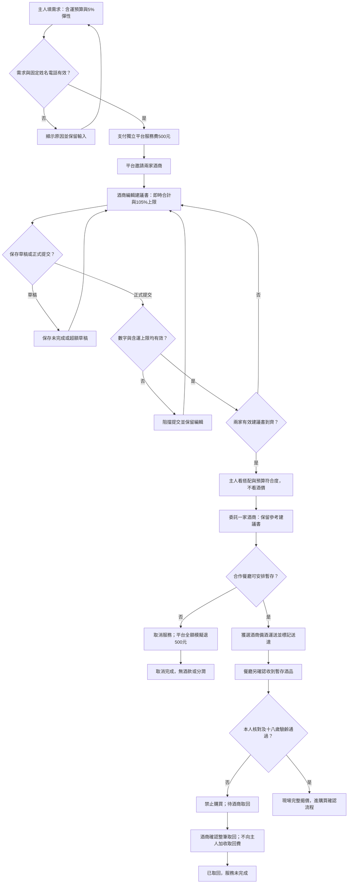
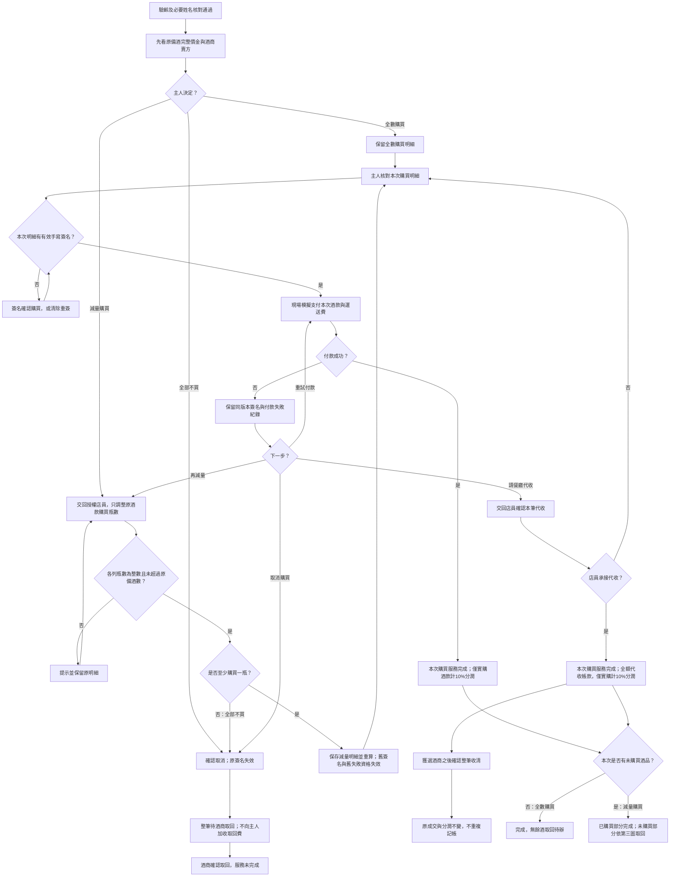
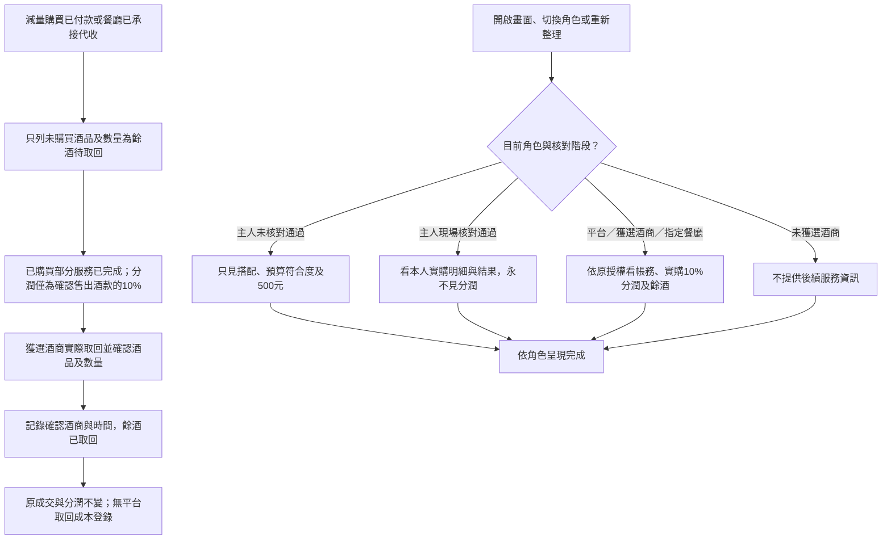

# Design

## Context

動機見[proposal.md](proposal.md)。現有實作為同一瀏覽器的React＋TypeScript strict＋Vite、原生CSS、npm與localStorage Demo，沒有後端、帳戶或真實金流。本次延續此已運作架構；不因通用設定列出的預設技術棧引入新系統。

已觀察到的落差：

| 區域 | 現況 | 本次設計 |
|---|---|---|
| `App.tsx:28,129,133` | 預算不含運送；主人可看單價及總額；超額仍可選 | 新預算含運、105%提交上限，主人只見符合範圍 |
| `model.ts:11,69-75` | `restaurantFee=300`進總額與驗證 | 移除新版固定餐廳費，僅保留獨立500元與酒商實購款 |
| `model.ts:103-125,201-209` | 付款、簽名、代收及分潤都取自選定建議書 | 改依獨立現場購買明細；原建議書不改寫 |
| `Checkout.tsx:19,21`與`App.tsx:134-135` | 主人也可見分潤與餐廳內部應付款 | 按角色與階段產生專用呈現資料 |
| `model.ts:212` | 只有整筆取消；沒有現場減量或餘酒取回 | 增加餐廳現場改單與正常餘酒取回紀錄 |
| `storage.ts` | schemaVersion 3，已有v1/v2遷移、固定姓名及舊單相容 | 保留原驗證鏈，純遷移至v4，區分舊預算與新政策 |

現場僅允許減少原備酒品項的購買瓶數，不換款、不新增酒款或超過原備酒數；全數、減量及全部不買為三個明確選擇。酒商是賣方、餐廳事先合作授權；本次不建立授權申請或審批系統。平台所有取回成本登錄一併移除。

## Goals / Non-Goals

**Goals:**

- 用同一份金額政策服務輸入提示、提交驗證、現場實購、簽名、付款、代收與分潤。
- 讓主人在驗齡前不見精確酒價，任何時點不見分潤；維持其他角色既有個資與未獲選限制。
- 允許原酒款實購數量少於備酒數，仍可追溯原建議、減量版本及未購買備酒去向；全數購買不建立餘酒待辦。
- 保留有效舊資料、簽名快照及已成交結果，避免以改版要求重付或重新演練。

**Non-Goals:**

- 正式登入／跨裝置權限、地理或裝置到場驗證、真實支付、完整倉儲與庫存盤點。
- 換款、新增酒款、超過原備酒數、手動改單價或運送費、付款後改單、退已成交酒款、部分收清、分潤實際支付、自動抵銷代收與分潤，以及任何平台取回成本登錄。
- 餐廳開瓶費等定價或代收；新建收件人／代簽人；主管機關合法性核准。

## Operation Flow

以下為待實作需求流程，非已執行結果。全數、減量、全部不買三路明確區分；全數與減量共用核對、簽名與付款，但只有未購買數量大於0才建立餘酒取回。所有取回均不需要平台登錄成本。

### 1. 需求、預算驗證與備酒

### 2. 現場購買、減量、簽名與付款

### 3. 餘酒取回及角色呈現

對應情境：第一圖涵蓋提案105%驗證、備酒安排與既有取消／驗齡失敗；第二圖涵蓋「現場減量後才依實購付款」「簽名後減量須重算重簽」「全數購買完成沒有餘酒待辦」及付款重試／代收；第三圖涵蓋「購買完成但餘酒尚待取回」「未購買備酒不得計入分潤」「獲選酒商確認餘酒取回」。舊單補填與必要姓名核對完成前，仍不可進第二圖。

圖表來源：[第一圖](operation-flow/flow-1.mmd)、[第二圖](operation-flow/flow-2.mmd)、[第三圖](operation-flow/flow-3.mmd)。三張圖已依本次修正以本機Mermaid CLI 12.2.0及既有Chrome重新成功渲染，並比對本節圖碼與.mmd來源一致。檢視：[第一圖SVG](operation-flow/flow-1.svg)、[第二圖SVG](operation-flow/flow-2.svg)、[第三圖SVG](operation-flow/flow-3.svg)。這是圖表驗證，不是產品E2E執行結果。

## Decisions

### 1. 金額與預算政策共用，先提示再送出驗證

新版需求記錄 `budgetPolicy: wine-shipping-105`，保留正安全整數預算B；新正式提交合計T為各品項瓶數×參考單價加運送費。比較使用整數運算 `BigInt(T) <= BigInt(B)*105n/100n`，上限向下取整；不直接以浮點1.05或溢位後乘法判斷。合計本身仍須為安全整數，缺數字時顯示待填妥。

酒商邊編輯邊看到合計、上限、剩餘／超額；`proposal-submit`在領域層重新驗證，不能只停用按鈕。草稿允許空白、小數或超額，正式提交仍須符合既有整數與新上限。保留上次成功狀態，拒絕不產生已提交事件。未選定前兩家建議書必須都有效才可選。

平台相關主人支出為500元獨立服務費＋實購酒款＋運送；不存在平台設定餐廳費或額外分潤加價。500元不納入105%判斷。餐廳自行開瓶費等只事前提醒依餐廳規定結帳，不加入本系統金額。

替代方案「提交後由平台退回重做」會浪費提案時間，故不採用。

### 2. 參考建議書與僅減量的現場購買明細分開保存

`selected`保留選定建議書與服務酒商，不改歷史內容或開放重選；這是追溯限制，UI不得說成已鎖定購買價量。未獲選酒商仍無後續資料。

新增`purchaseDraft`，包含items、shipping、revision、updatedBy及updatedAt。驗齡與必要本人核對通過後，從原備酒建立第一版，保留原列識別、品項、容量、單價與運送費，預設購買全數；建立草稿不等於購買或付款。

主人可選全數購買、減量購買或全部不買。只有指定授權餐廳可在交回店員後調整各原酒款的購買瓶數；數量為0至原備酒數的安全整數，至少一款大於0。0瓶代表不買該款，不進實購計價列；全為0則提示走既有整筆取消。品項、容量、單價與已揭露運送費均唯讀，不新增、換款、加到超過原備酒數或手動改價。運送已發生，減量不自動減免原運送費。

保存有效減量後，直接回主人核對新明細、簽名及付款，不能再繞回「主人決定？」要求選購買方式。新簽名綁本次數量；若原明細已簽，舊簽名失效。直接付款與代收成功後都檢查「是否有未購買酒品」：全數購買直接完成、無餘酒待辦；減量才接餘酒取回。

新版實購仍須在含運105%上限內；在原提案有效、單價與運送費不變且不超備酒數時自然不會超過原含運合計，但仍保留領域驗證防止偽造命令。舊資料原明細可沿用，新減量只允許依其原備酒減少瓶數，不追溯追加5%額度。

可減量狀態限驗齡通過且待購買確認／待付款。代收待承接、完成、取消或退回不可變更；拒絕代收回待付款後才可重新交店員。有效減量增加版本，無效保存不改最後成功明細與簽名。不建立完整庫存系統，未購買數量由原備酒減實購自動計算。

### 3. 簽名與付款綁定同一購買版本

`receiptSnapshot`、`signatureValid`、酒款付款、代收帳款及`finish`改依purchaseDraft的實購items與shipping。付款為酒款加運送；分潤為成交酒款10%，沿用整元四捨五入，不含運送及500元。

簽名另記購買版本；減量新版本使舊簽名失效並要求重新核對與手寫。付款嘗試也記版本：歷史失敗仍可追溯，但舊明細失敗不能用來跳過新明細付款嘗試直接申請代收。同明細、同版本失敗可沿用有效簽名重試。

保留`completedBy: online`等既有內部相容識別字即可，畫面與事件呈現改「現場模擬付款」；識別字不代表正式遠端支付支援。完成仍只接受現場模擬支付成功或店員逐筆承接代收，沒有再按交付／收取步驟。重複命令維持冪等。

### 4. 未購買餘酒取回與整筆失敗退回分開，移除所有平台成本登錄

`unusedStock`只記未購買酒款、數量、pending／returned、確認酒商與時間；不包含成本欄位。由原備酒與實購差額計算：全數買下差額為0，不建立取回紀錄或待辦；減量時，成交後只為正差額建立待取回。保存減量草稿時可預覽差額，但若最後整筆取消，改走整筆退回，不重複建立餘酒與整筆取回紀錄。

已購買部分在付款成功或餐廳承接代收時即完成服務。餐廳分潤只按確認售出酒款金額10%計算，未購買備酒完全排除。例如備6瓶每瓶1000元、實購4瓶加運送200元，應付酒商4200元、分潤400元；2瓶取回不再增減原分潤。

只有獲選酒商可確認實際取回，保存品項、數量與時間；重送不新增事件。完成後只額外開放該餘酒確認及原有代收收清，不重開購買、付款或正常履約。

移除所有平台取回成本輸入、摘要、待登錄狀態及`cost`命令，適用減量餘酒、整筆取消、驗齡未過與姓名核對失敗。現有`returnCost`與舊成本事件只在相容遷移時原樣保留於歷史metadata，不提供任何角色現行登錄或呈現；不得用舊操作更新成本。移除的是系統登錄，原費用負擔及不向主人加收取回費的規則不變。

全部不買、本人不符或驗齡失敗仍走既有`return-pending`／`returned`，原原因、服務費退款／不退分支保留，酒商確認整筆取回即可結束，無需平台配合成本操作。對應新增service-exceptions差異，明確移除主規格原有成本紀錄要求。

### 5. 呈現資料依角色與階段集中組成

建立明確的主人／內部呈現型別與轉換，不把原完整Order直接交給主人元件，也不僅用CSS隱藏。金額計算留領域模型，不能因遮蔽而把原價改成0或NaN污染付款。

| 角色／階段 | 可見 |
|---|---|
| 主人、未通過現場核對 | 自填預算、500元服務費、建議酒款／容量／瓶數、搭配理由、預算範圍標章 |
| 主人、現場核對通過 | 上述＋實購單價、小計、運送、應付酒商合計及本人付款／代收結果 |
| 主人、所有階段 | 永不呈現分潤比例金額、待結算、餐廳對酒商應付款 |
| 受邀酒商、選定前 | 本人提案完整輸入與合計，仍不見主人姓名電話；不展示本筆尚未成立分潤 |
| 平台、獲選酒商、指定餐廳 | 各自原有授權資料及本筆內部分潤／帳款／餘酒；酒商仍不見主人個資及筆畫 |
| 未獲選酒商 | 維持無後續服務資料，不由事件數、錯誤或內部帳務透露結果 |

現場guest模式僅含主人本筆明細、簽名、付款、取消與交回裝置，完成頁也套主人規則。付款失敗後先顯示不含內部分潤的handoff提示；只有店員接回轉staff確認後才顯示餐廳帳務。重新整理按已保存角色／模式重建，不能先閃現前一角色內容。

主人可見自由文字須防止可辨識報價／分潤夾帶：新提交前辨識NT$、NTD、新臺幣、金額加元、明確報價／分潤語句等並提示移到內部金額欄；不可一概封鎖數字，750ml、6瓶、日期與時段應可用。舊文字按角色與階段遮蔽可辨識金額片段；保留內部原文。這是呈現規則與已知格式測試，不宣稱可理解任何自然語言或正式資料保密；localStorage與示範角色可由同機使用者檢視。

### 6. 文案與警語採統一對照

| 舊用語 | 新用語 |
|---|---|
| 宴客酒款媒合平台 | 宴客餐酒搭配諮詢與協調平台 |
| 姓名（下單及簽收人） | 宴客聯絡人姓名 |
| 酒款總預算 | 酒類與運送預算 |
| 選定酒商 | 委託此酒商安排現場備酒 |
| 已鎖定的協調條件／條件鎖定 | 本次搭配建議書／已確認服務酒商 |
| 配送／餐廳收貨 | 備酒運送／餐廳確認收到暫存酒品 |
| 本人簽收／保存簽名 | 現場購買確認／保存購買確認簽名 |
| 線上模擬付款成功 | 現場模擬付款成功 |

需求說明：「平台將協助邀請酒商，提供酒款與運送費合計最高不超過您填寫預算105%的搭配建議書。平台諮詢與協調服務費500元另計。餐廳如有開瓶費等費用，依餐廳規定另行結帳。」

委託說明：「委託此酒商依宴客需求提供搭配建議，並安排現場備酒。本次選擇不成立酒類購買義務；酒款價金於現場核驗年齡後、簽名前完整提供，您可核對後決定是否購買。」

驗齡按鈕改「已核對本人且年滿十八歲」。酒款展示、建議書與購買確認明顯顯示「禁止酒駕」「飲酒過量，有害健康」「未滿十八歲者禁止飲酒」；維持DEMO及不收真實卡號／證件。內部待辦、通知、完成頁與舊事件投影同步，不只修改按鈕。

## Risks / Trade-offs

- [營運模式仍有法律爭議] → 這些功能與文案是已確認的產品規劃，不構成合法保證；官方預約鑑賞送店案例仍遭裁罰，正式營運另取得專業／主管機關確認。[法條](https://law.moj.gov.tw/LawClass/LawAll.aspx?pcode=G0330011)、[案例](https://www.laws.taipei.gov.tw/law/LawDecision/ContentExport?id=1242-007)。
- [晚揭價可能讓主人預期不同] → 需求提交前先說明含運及5%彈性，現場先明細再簽名，允許減量與整筆取消，減量直接接續新明細簽名付款。
- [備貨與未成交成本] → 由原備酒減實購推得餘酒，酒商確認取回，平台無成本登錄；不向主人加收或阻擋已購買部分完成。
- [自由文字漏價或誤擋] → 使用已知格式偵測與欄位提示、舊資料遮蔽及正反例測試；不宣稱自然語言完全防漏。
- [展示不能證明人在現場或真實授權] → 保留餐廳人工核對、同裝置交接及角色守門，展示說明明示限制；不使用可在公開網站遠端結帳的文案或新增支付接口。
- [歷史資料與新政策差異] → 版本化預算及明細，先驗證舊資料再遷移，不偽造新上限通過或改寫已簽價金。

## Migration Plan

1. 實作前保存目前v3的未選定、已選定、已簽未付、直接付款完成、代收待收清／已收清、取消及驗齡退回樣本，另沿用既有v1/v2樣本；樣本只含模擬資料。
2. 將現行v3驗證保留為歷史驗證器，新增schemaVersion 4與純函式遷移。v1/v2先依既有鏈變v3，再轉v4；讀取不立即寫回，成功操作才寫新格式。沿用KEY，不清除其他key。
3. 新版Proposal不帶restaurantFee；舊300元欄位保留於內部歷史原文／metadata供追溯，不成為任何新的主人應付額或公開費用，不補造退款。保留原簽名snapshot、付款／代收與commission數字及時間。舊returnCost及成本事件原樣保留於歷史metadata，不作現行畫面、待辦或可重送命令。
4. 舊資料標示原預算與歷史提案資格；不能用新版「符合設定預算範圍」替代。新正式提交／重新提交切換該提案為新版含運105%政策，既有小數歷史例外不擴及新提交。已選定或成交資料不追溯被新上限拒載。
5. 已簽或已成交舊單由原snapshot重建相同實購內容，綁定相容revision，不要求重簽重付，不發明餘酒。未簽資料以原selected作現場初值；既有補填姓名／核對守門保留。
6. 主人所有舊單仍套新版分潤與價格呈現規則；歷史事件以投影轉換而不改原帳務。舊簽名、日期已近／已過均不因新文案失效。
7. 以Vitest驗證遷移、金額與守門，Playwright MCP執行本change的E2E；若需回復舊程式，先匯出新v4資料與樣本，還原先前備份，不將v4直接交舊v3載入器而冒稱相容。

正式營運的法律適用是外部後續工作，不是未決的Demo實作範圍。本change沒有需等新商業決策才能拆解的Open Questions。
