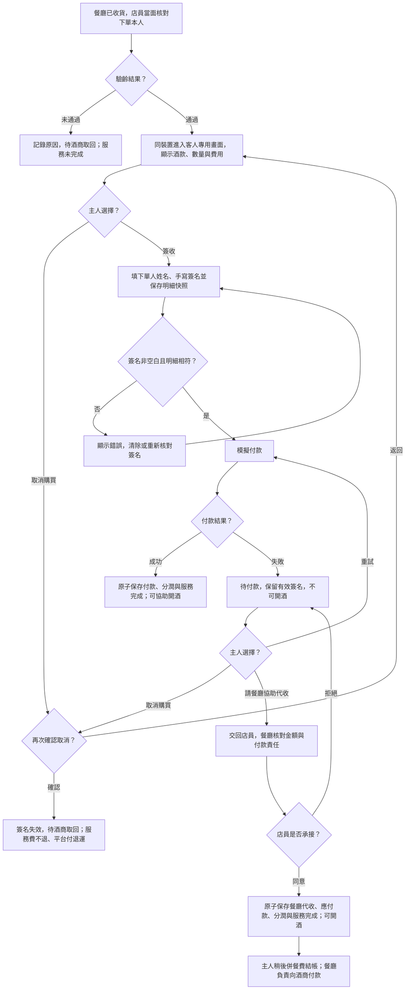
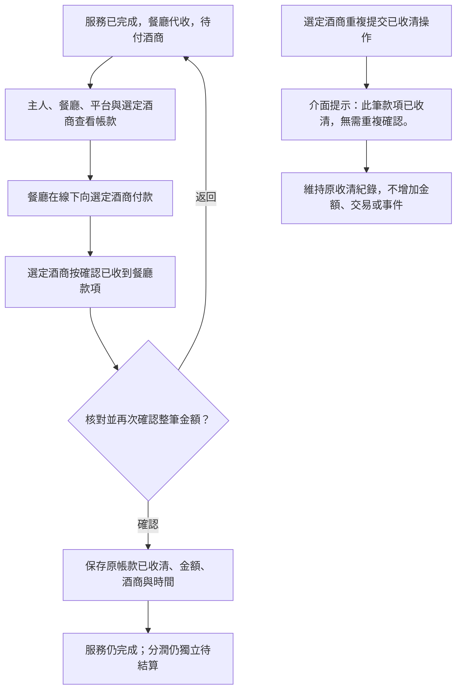
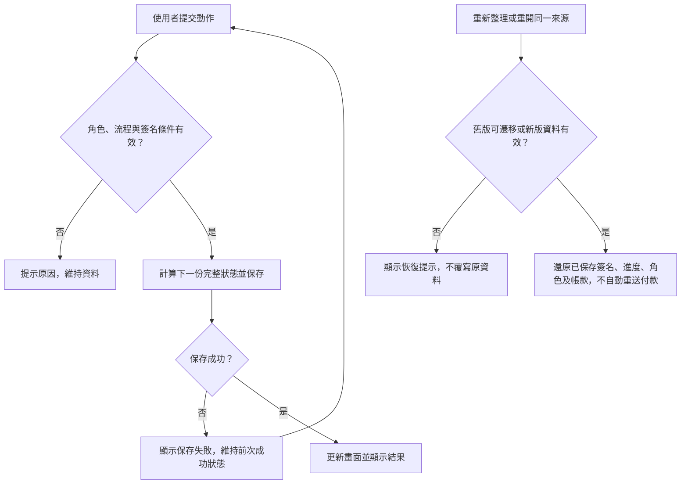
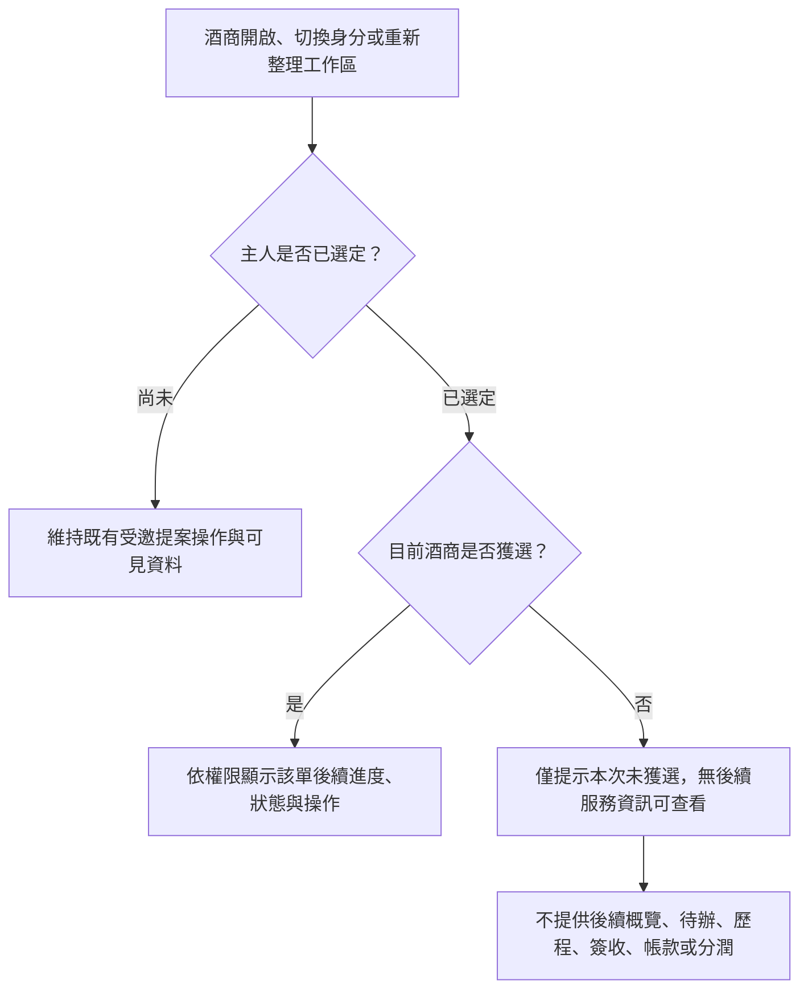

# Design

## Context

動機與已確認範圍見 [proposal.md](proposal.md)。目前 `src/domain/model.ts` 的 `transition()` 以角色與狀態授權，每種命令依操作名稱永久去重；付款只存在成功結果，必須再經 `handover`、`complete`。`src/persistence/storage.ts` 又把完成與已付酒款綁定，把退回與驗齡失敗綁定，不能只改畫面。

`src/app/App.tsx` 透過 `commit()` 先成功保存才更新 React 狀態，這個契約須維持。`Request` 沒有姓名或正式帳戶；下單本人仍由店員人工核對，簽收時填寫下單人姓名作紀錄，不能把姓名輸入當成身分驗證。既有 Demo 用固定角色、localStorage、npm、原生 CSS；延續展示用途，不擴建後端或金流。既有測試「付款後不能完成」會被新流程取代，但配送前置、異常取回及原日期／料理規則仍須回歸。

## Goals / Non-Goals

**Goals:**

- 將履約狀態、客人／店員操作畫面及帳款收清分開表示，避免把服務完成當成酒商收款。
- 維持領域授權、付款／承接／分潤的單次提交與保存失敗不成功的原則。
- 以簽署快照核對每次付款或承接，支持滑鼠與觸控，並可還原已保存進度。
- 相容處理舊版已保存狀態，不刪除資料、不要求重付、不造簽名。

**Non-Goals:**

- 正式帳戶或員工驗證、簡訊、跨裝置同步、真實金流、催收／到期通知、部分收款、淨額抵銷。
- 代收人的驗齡簽收、餐廳向主人收款的另一套平台操作、開瓶按鈕、完成後退款／退酒／改支付方式。
- 分潤支付與收款；酒商確認收到代收款不能改變分潤待結算。

## Operation Flow

### 桌邊簽收與服務完成

入口為餐廳已收貨、店員持酒到下單本人面前。對應 `餐廳登錄通過`、`保存有效簽名`、`失敗後重試成功`、`主人提出代收請求`、`店員承接代收`、`店員拒絕代收` 及兩個取消情境。取消購買只能發生在尚未完成時；代收請求尚未被承接不算完成。

取消確認返回原進度；圖中共用返回節點以簽收入口表示，已簽或已付款失敗時仍保留相應進度。任一保存節點失敗時均套用下方保存流程，不能先顯示完成再補存。付款前清除已保存簽名必須先使其失效，不得繼續使用原快照。

### 酒商收清代收款

此流程接續代收服務完成，僅向主人、餐廳、平台與選定酒商提供相關資訊；未獲選酒商自主人選定起就沒有後續訂單資訊，不列為此收清旅程的使用角色。對應 `全額應付款與分潤並列`、`餐廳承接但酒商未收款`、`酒商收清全額` 及 `重複收清操作顯示提醒`。

### 保存、重新整理與重試

適用 `無法保存時顯示錯誤`、`簽名與付款失敗接續`、`代收與收清跨重新整理保存` 及既有資料相容情境。

### 主人選定後的酒商資訊可見性

入口為酒商開啟工作區、切換身分或重新整理。選定成功起即套用選定關係；無論訂單後續正常完成、代收、收清、取消或退回，未獲選酒商均不再取得相關資訊。對應 `選定後進入協調`、`未獲選酒商不得讀取後續資訊`、`任一家酒商未獲選均適用` 及 `未獲選身分切換與重新整理不洩漏進度`。

四張圖均已在本機通過 Mermaid 渲染；2026/11/09 重新渲染修正後的酒商收清圖與新增的資訊可見性圖，其餘兩圖原稿未變。原稿與 SVG 位於 [operation-flow](operation-flow/)。審閱圖：[桌邊服務](operation-flow/flow-1.svg)、[酒商收清](operation-flow/flow-2.svg)、[保存與接續](operation-flow/flow-3.svg)、[酒商資訊可見性](operation-flow/flow-4.svg)。圖表驗證僅代表語法與渲染成功，不代表產品功能已實作或測試通過。

## Decisions

### 1. 履約、操作畫面與金流結果分離

新流程採 `age-check-pending → signature-pending → wine-payment-pending → completed`，另設 `collection-review-pending` 表示主人提出代收、等待店員確認。付款失敗保留待付款並增加嘗試紀錄；代收拒絕回待付款，可重試、再請求或取消。所有終止與已完成狀態由領域層阻擋其他路徑，不依賴按鈕隱藏。

持久化 `checkout` 內容包括客人／店員操作模式、簽收、付款嘗試、代收請求、完成方式與時間。驗齡通過後自動使用主人操作上下文，隱藏全域角色與重設；客人按請餐廳協助代收後顯示交還裝置提示，再明確進入店員確認上下文。此切換只是同裝置交接與示範授權，不能驗證實際拿裝置的人。完成頁可有「返回餐廳工作區」作導覽，不能再成為完成服務的必要條件。

不沿用 `winePayment.paid = true` 代表餐廳承接，因它會把尚未收款記成收款。保留線上成功交易資料，新增獨立 `collection` 紀錄；`commission` 可由兩條已完成路徑支持，保存驗證也須接受代收完成而無線上成功付款。

### 2. 簽收快照與手寫資料

新增具可見標籤的「下單人姓名」欄位及可用 Pointer Events 的簽名畫布；文字聲明寫明確認當面核對的酒款、數量與金額，同意在付款成功或餐廳承接代收後接收酒品。空白不通過；清除使已存簽名失效，再簽需重新保存。

以可驗證、有限大小的筆畫座標資料保存，不接受任意 HTML／SVG；畫布按標準座標繪製，大小變化與裝置像素密度不能清掉已保存筆畫。記錄姓名、時間、訂單、選定酒商、酒款各項與數量、酒款小計、配送及總額的不可變快照。付款、請求代收、承接時均比較快照；不因原提案通常已鎖定便略過核對。原圖僅按角色渲染，不放在通用歷程摘要或酒商 DOM。

逐筆畫只更新未保存草稿，按「保存簽名」成功才算有效；重新整理僅保證已保存資料。署名與簽名資料都不能被描述成正式帳戶驗證。相較只用勾選框，手寫符合已確認需求；不加入圖檔上傳或外部簽署服務。

### 3. 餐廳代收與酒商整筆收清

`collection` 一對一綁定訂單，保存餐廳 ID、選定酒商、酒款、配送、全額、承接角色及時間、`pending/received`、收清角色／時間／金額。只由符合前置條件的餐廳承接命令建立；收清只允許選定酒商更新原紀錄，金額固定為全額，不提供任意編輯或部分付款。

範例：餐廳對酒商待付款 6200，酒商對餐廳待結算分潤 600；不抵銷為 5600。餐廳承接本身已確立對酒商責任，不追蹤主人何時付餐費，不提供「主人尚未付所以取消責任」按鈕。酒商確認收清後，支付方式仍為餐廳代收，分潤仍待結算。

### 4. 一次提交完成、重試與去重

正常付款／承接使用單一領域轉移建立完成結果與分潤，後者同時建立帳款，透過既有 `commit()` 一次保存。保存失敗時整筆不成功；不先記完成再補記帳款，也不對外呼叫支付。

既有「同 action 與 actor 永久去重」不適用付款失敗後重試及代收被拒後再次請求。對可重試動作使用每次明確提交的 operation ID，重送同一 ID 不重複記錄；合法的新嘗試可再執行，已完成的金融結果則以終態及唯一紀錄保護。簽名修改只限完成前。把新命令前置條件與唯一性納入單元測試，而非僅靠禁用按鈕。

重複收清不是新的成功收款。領域結果須區分「本次接受」與「原已收清」，介面在選定酒商重複提交時以可見、可被輔助技術讀取的狀態訊息顯示「此筆款項已收清，無需重複確認。」；保留原金額、操作者與時間，不增加業務事件。不能僅靠第一次成功後移除按鈕，便省略快速重複點擊或原提交重送時的回饋。確認角色與選定關係先於重複結果回傳，未獲選酒商不得透過重複提示推知收清狀態。

### 5. 主人取消購買使用獨立退回原因

加入 `returnReason` 類型區分 `age-failed` 與 `host-cancelled`，不把已驗齡通過改寫為失敗。取消確認後失效簽名、退出客人流程並走現有 `return-pending → returned`。服務費與退運沿用已確認規則；平台可在取回前後登錄成本，空值與零元仍不同。退回頁、酒商取回提示、平台成本與歷程均讀取真實原因。

### 6. 舊資料相容與展示說明

將擴充格式版本化（`schemaVersion: 2`），保留現有 storage key 以讀到舊單。分開嚴格驗證舊版與新版，對有效 v1 純資料遷移；讀取不立即覆寫，成功操作才保存新版。v1 未付酒款但已驗齡的購買／付款中訂單進入新簽收流程；v1 已付酒款而仍待交付／收取的訂單保留舊履約結果與原狀態，以標示「舊版流程」的相容操作結束，不重付、不回造簽名、不重建分潤；已完成／取消／退回保持原結果與事件。這些相容操作僅對舊版來源資料開放，新單不可跳過簽名。

載入舊單仍不套用新建日期門檻。真正損壞資料保留原本恢復提示；回退舊程式前需使用部署前保留的 v1 快照，不將 v2 假裝成 v1。實作前先用現有 UI 在隔離瀏覽器保存代表性 v1 快照。維持既有四個情境入口，驗齡前入口足以進入新流程；模擬付款畫面以「模擬付款結果」提供成功／失敗測試，不收集真實卡號。更新 README 與 `docs/demo-runbook.md` 說明所有金額與角色均為示範。

### 7. 未獲選酒商的讀取邊界

主人選定後，先依角色與選定酒商產生可用的訂單檢視資料，再渲染各區塊；未獲選酒商僅取得未獲選提示及可選保留的本人選定前提案，不取得當前訂單狀態、選定後事件數量或其他後續資料。不能把完整訂單傳入概覽、待辦、右欄財務、分潤與歷程元件，再只隱藏收清按鈕。返回工作區、切換角色及載入時均先決定可見資料，避免短暫呈現前一角色的資訊。

領域的資訊讀取與命令授權都檢查選定關係，不因曾被邀請或提案仍存在便保留後續存取權。酒商甲與乙須對稱測試；舊資料載入亦套用同一可見性。這仍是單一瀏覽器 Demo 的介面與應用邏輯邊界，localStorage 不是正式多帳戶的隔離儲存，不新增後端或宣稱可防止持有本機開發工具者讀取資料。

## Risks / Trade-offs

- [同裝置無法證明實際操作人的身分] → 明示示範限制，店員核對本人；客人畫面隔離操作，領域檢查角色與上下文，不宣稱正式登入。
- [簽名資料占用 localStorage 或損壞] → 限制格式與大小、驗證筆畫；保留保存失敗與不覆寫資料契約。
- [付款成功與代收承接同時提交造成雙帳] → 單一最新狀態、operation ID、完成終態與唯一付款／帳款／分潤檢查；不把多分頁或多裝置同步當成已支援。
- [服務完成卻誤示酒商已收款] → 完成、支付方式、應付款及分潤分開呈現，收清只改帳款。
- [舊單被新簽名要求擋住或重付] → 使用遷移來源標記與相容路徑，以真實舊版 UI 快照驗證，不放寬新單前置條件。

## Migration Plan

1. Apply 前先保留代表性 v1 快照：驗齡前、已驗齡待購買／付款、已付待交付／收取、已完成及異常。
2. 先完成領域狀態、帳款、轉移與去重測試，再完成 v1 遷移與 v2 保存驗證，最後接上簽名與交接畫面。
3. 更新同一組單元測試、展示手冊與 README；使用 `npm.cmd run test -- --run`、`npm.cmd run build` 及本 change 的 E2E 清單驗證。
4. 本輪只建立規劃文件；實作後才填寫 E2E 結果、證據與 tasks 完成狀態。回退前保留目前資料與原快照，不以重設掩蓋相容問題。
